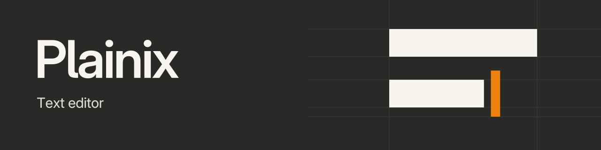

# 

Plainix is a lightweight text editor with tabs and JSON highlighting. Open a note, edit a configuration file, or follow a request through a log in the same window.

Plainix is the new name of the Web-Usov fork of Notepads. Builds through 1.7.0.2 use the earlier name.

## Install on Windows

Open the [latest stable release](https://github.com/Web-Usov/Plainix/releases/latest) and expand **Assets**. For versions with a native installer, download its `.appinstaller` and `.cer` files together. For offline installation or version 1.6.0.0, download the complete ZIP. To try changes still under development, use a [pull request build](CONTRIBUTING.md#try-a-pull-request-build).

| Build | Native installer | Public certificate | Start menu name |
| --- | --- | --- | --- |
| Plainix (from 1.7.0.3) | `Plainix.appinstaller` | `Plainix.cer` | Plainix |
| [Notepads 1.7.0.2 preview](https://github.com/Web-Usov/Plainix/releases/tag/v1.7.0.2-preview) | `Notepads.appinstaller` | `Notepads.cer` | Notepads-Dev |

1. Download the public certificate from the release and compare its SHA-256 with the fingerprint in the release notes. The first time you install a package from that signer, open the certificate and choose **Install Certificate → Local Machine → Place all certificates in the following store → Trusted People**. This step requires Windows administrator approval.
2. Download the matching `.appinstaller` file, double-click it, and choose **Install** or **Update**. Windows App Installer downloads the editor and its x64 frameworks. An update from the Web-Usov fork reuses the existing package identity and local data, including installed extensions.
3. Open the editor from Start. Stable builds check for updates when the app starts. Each preview points to a specific version. A future SignPath Foundation release will use a different package publisher and **cannot automatically upgrade** the old self-signed package; see [publisher migration](docs/installer-publisher-migration.md).

Windows 10 build 17763 or later and Windows 11 x64 are supported. Windows App Installer must be installed. On Windows 10 versions before 2004, enable sideloading of trusted apps in Windows settings. The [v1.6.0.0 release](https://github.com/Web-Usov/Plainix/releases/tag/v1.6.0.0) and offline installations use the complete ZIP. Extract it, open PowerShell in its folder and run:

```powershell
powershell.exe -NoProfile -ExecutionPolicy Bypass -File .\Add-AppDevPackage.ps1
```

## Code signing policy

**Signing status:** Release v1.7.0.3 uses a **self-signed certificate**, so the existing certificate-import procedure above is still necessary. Plainix is preparing an application for **SignPath Foundation** and has **not yet received a trusted signing certificate**. Do not install untrusted certificates from unofficial sources.

Free code signing provided by [SignPath.io](https://about.signpath.io), certificate by [SignPath Foundation](https://signpath.org/) **once approved and activated**. See the project's [Code signing policy](docs/code-signing-policy.md), [application/readiness checklist](docs/signpath-foundation-application.md) and [migration instructions](docs/installer-publisher-migration.md). Windows SmartScreen reputation warnings are independent of package signature trust.

## Use the editor

To use Russian, open **Settings → Advanced → Language Preferences**, select **русский** and restart the editor. Select **System Default** in the same list to use the Windows language preference again.

- Open text files up to 1,000 KiB in tabs. Press **Ctrl+T** to create a tab and **Ctrl+Tab** to switch between tabs.
- Split editor tabs to the right or below using the **Split editor** button beside the new-tab button, the main menu, or the tab context menu. Both panes have independent tab strips and a resizable divider; drag a tab into the other editor group (the target is highlighted while dragging), or right-click the tab and choose **Move to group → Group 1 / Group 2**. There are no dedicated tab-transfer buttons. **Close split** merges all tabs back without closing documents. Use **Ctrl+Alt+Right/Down** to split, **Ctrl+Alt+Up** to merge, and **Ctrl+Alt+PageUp/PageDown** to focus the first/second group. The session backup remembers the split orientation, tab groups and selections. See [Split editor architecture](docs/split-editor.md).
- In a Markdown file, press **Alt+P** to toggle the live preview. Press **Alt+D** to compare your edits with the saved version of a file.
- Open a `.json` file for live highlighting. In **Main menu → Extension commands**, choose **Format JSON** or **Minify JSON** for the current selection or the whole document.
- Select a request ID in a log, then choose **Main menu → Extension commands → Open Log Lens**. Filter by severity and select a result to jump to its original line.
- Install and manage extensions under **Settings → Advanced → Extensions**. Choose a local JSON manifest or ZIP, or enter an HTTPS link to a manifest, ZIP or public GitHub repository or release. See [installation and updates](docs/extensions.md#install-update-and-distribute).

Screenshots from the original Notepads interface · [Dark theme](ScreenShots/1.png) · [Markdown preview](ScreenShots/2.png) · [Diff viewer](ScreenShots/3.png) · [Light theme](ScreenShots/4.png)

## Create an extension

A UTF-8 JSON manifest can declare highlighting rules, commands and read-only panels. The [plugins directory](plugins/) contains the bundled JSON Tools and Log Lens plugins and a separately installable Markdown example.

- [Extension authoring guide](docs/extensions.md) — build a `.todo` grammar, add an editor command, or package an extension for GitHub.
- [Wrap in bold](plugins/examples/markdown-wrap/wrap.notepads-extension.json) — a working command that adds Markdown delimiters to the current selection.
- [Agent skill](.agents/skills/create-notepads-extension/SKILL.md) — use the repository workflow to create and verify a manifest with a coding agent.

## Project

See [Contributing](CONTRIBUTING.md) for source builds, tests, PR installers and release instructions. Coding agents can start with the [repository instructions](AGENTS.md). The [privacy notes](PRIVACY.md) describe local storage and diagnostics. The [code of conduct](CODE_OF_CONDUCT.md) applies to contributions.

Plainix builds on [Notepads by Jackie (Jiaqi) Liu and its contributors](https://github.com/0x7c13/Notepads). Yi Zhou and Mahmoud Qurashy contributed the original app and file icon artwork. See the [MIT license](LICENSE.txt) and the [Plainix brand assets](docs/brand/).
